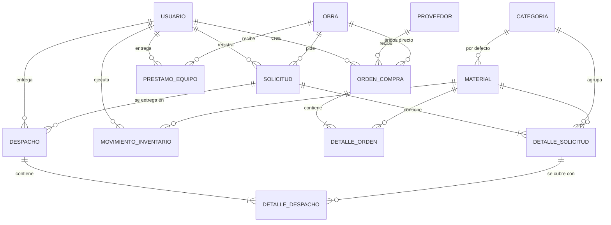

# Levantamiento de Requerimientos — Sistema de Inventario Río Bravo

> **Fuente de verdad:** el desarrollador responsable (respuestas registradas en §10). Este documento manda por sobre el diagrama de clases original (`Docs/Diagrama de clase.png`) y por sobre el código heredado.
> **Versión:** 1.1 · **Fecha:** 2026-10-14 · **Estado:** respuestas del cliente incorporadas (§10, R-20..R-33); quedan pocas preguntas abiertas (§11).

---

## 0. Guía rápida para sesiones con IA

Lee esto primero si eres una IA que retoma el proyecto:

1. **Qué es:** app de escritorio WinForms (.NET Framework 4.7.2, C#) + PostgreSQL en Supabase (Npgsql 6.0.11) para que la constructora Río Bravo **compre** y **despache** materiales a sus obras (y controle los equipos que les presta), con registro trazable de cada movimiento. **No vende a terceros** (R-29).
2. **El código y la BD heredados son incorrectos** (ver §2). No los tomes como referencia de diseño; el modelo válido es el de §6.
3. **Las 9 planillas Excel de `Docs/`** son registros de *salida de materiales* de una obra cada una. Se reemplazan por una vista del sistema con formulario estandarizado e imprimible (§8).
4. **Simplicidad ante todo:** el cliente pidió un sistema simple. 3 roles, 1 bodega, sin abstracciones innecesarias.
5. Lo marcado **[PENDIENTE]** no está decidido: no lo inventes, pregunta o deja el punto configurable.
6. **Estado de implementación (2026-10-14):** hecho = login/roles/usuarios, conexión por `.env`, Inicio (resumen), catálogo y stock (RF-04, RF-06, RF-07), ajustes, devoluciones de obra y kardex (RF-24, RF-25), obras con datos del beneficiario (RF-12..RF-14), solicitudes, aprobación, material extra, despachos parciales e impresiones 1 y 2 (RF-15..RF-20), equipos prestados (RF-27). Pendiente = categorías editables (RF-05), proveedores y compras (RF-08..RF-11), reportes (RF-26), carga del catálogo maestro (§8.4: propuesta en `CATALOGO_MAESTRO.md`, esperando revisión).
7. **Cambios de BD después de producción:** van como script en `Database/migraciones/` (se ejecutan una vez en Supabase) **y** se reflejan en `Database/schema.sql` (BD nueva/local). Aplicadas en producción: `001_respuestas_cliente.sql` (2026-10-14).

### 0.1 Mapa de pantallas (dónde está cada cosa)

| Menú / acceso | Pantalla | Qué se hace ahí | Quién |
|---|---|---|---|
| Al iniciar sesión | `FormPrincipal` (Inicio) | Tarjetas: materiales bajo mínimo, obras en ejecución, solicitudes por aprobar y por despachar. Listas con doble clic para abrir. | Todos |
| Inventario → Materiales y stock | `FormMateriales` | Buscar, ver stock (rojo = bajo mínimo), crear/editar material, ajustar stock, ver movimientos | Editar: Gerente, Jefe de Compras · Ajustar: Gerente, Bodeguero |
| Inventario → Ajuste de inventario | `FormAjuste` | Entrada/salida con motivo (inventario inicial, conteo, merma). **Devolución de obra** = entrada indicando la obra (resta del costo de la obra) | Gerente, Bodeguero |
| Materiales → Ver movimientos | `FormKardex` | Historial con saldo, documento y obra | Todos |
| Obras → Lista de obras | `FormObras` / `FormObraEditar` | Crear/editar obra (encabezado de la planilla, beneficiario con RUT y teléfono), costo despachado vs. presupuesto | Editar: Gerente |
| Obras → Equipos prestados | `FormEquipos` | Prestar trompo/placa/baño químico a una obra y registrar su vuelta a bodega; lista de los que siguen fuera | Prestar/devolver: Gerente, Bodeguero |
| Solicitudes → Nueva solicitud | `FormSolicitud` | **El formulario estandarizado** (§8.2): agregar materiales por sección, guardar, aprobar/rechazar, despachar, pedir material extra, imprimir | Registrar y aprobar: Gerente, Bodeguero |
| Solicitudes → Ver solicitudes | `FormSolicitudes` | Filtrar por obra y estado, abrir planilla | Todos |
| Planilla → Nuevo despacho | `FormDespacho` | Cantidad entregada hoy por línea (≤ saldo y ≤ stock); descuenta stock e imprime comprobante | Gerente, Bodeguero |
| Administración → Usuarios | `FormUsuarios` | Usuarios y roles | Gerente |

Fechas de documentos: las envía la app en hora local del PC (`ConexionBD.AgregarAhora`), porque el servidor de Supabase está en UTC.

---

## 1. Contexto y alcance

Río Bravo es una constructora de casas (modelos de 68–80 m²). Compra materiales a proveedores, los guarda en **una bodega central** y los despacha a sus obras. Hoy cada obra se controla con una planilla Excel distinta, sin catálogo común ni stock central.

**Objetivo:** que el stock, lo despachado a cada obra y su costo se obtengan de movimientos registrados, no de planillas escritas a mano.

### Dentro del alcance
| Módulo | Qué cubre |
|---|---|
| Catálogo | Materiales (código, nombre, unidad, stock, stock mínimo, precio), categorías |
| Compras | Proveedores, órdenes de compra con detalle, recepción en una o varias entregas (suma stock) |
| Solicitudes y despachos | La obra solicita material (= la planilla), aprobación, despachos parciales (restan stock), comprobante imprimible |
| Equipos | Préstamo de trompo (betonera), placa compactadora y baño químico a obras, y su devolución |
| Inventario | Kardex de movimientos, ajustes, devoluciones de obra, alertas de stock mínimo |
| Obras | Registro de obras, estado, presupuesto de materiales, costo acumulado |
| Usuarios | Login, 3 roles, gestión de usuarios por el Gerente |

### Fuera del alcance (por ahora)
- Múltiples bodegas o bodegas por obra.
- Facturación electrónica / integración contable.
- Importar los datos históricos de las 9 planillas (el usuario eligió reemplazar Excel, no migrarlo).
- Acceso del maestro u obra al sistema (no es un rol; ver RN-02).
- **Ventas a terceros:** no existen (R-29). Se eliminaron del modelo.
- **Modelos de casa con lista base de materiales:** no se pidió (R-25).

---

## 2. Diagnóstico del proyecto heredado

El proyecto actual (compañero) **no cumple** los requerimientos. Hallazgos:

| # | Hallazgo | Archivo | Decisión |
|---|---|---|---|
| D-01 | **Contraseña de Supabase escrita en el código** y ya presente en el historial de git (commit `647bf77`). | `Data/ConexionBD.cs` | **Rotar la contraseña en Supabase de inmediato.** **Resuelto:** la app usa el usuario limitado `app_riobravo` (no `postgres`); la conexión se configura en un archivo `.env` fuera de git (ver RNF-02). |
| D-02 | BD con una sola tabla `Solicitud` que mezcla artículo (texto libre), obra (texto libre), stock y estado. No hay materiales, obras, proveedores, compras ni movimientos. | `Views/FormNuevaSolicitud.cs` | Descartar. Se rehace la BD según §6. |
| D-03 | `stock_actual` se copia en cada solicitud y se lee de la última fila: el stock no se calcula ni se descuenta. | `FormNuevaSolicitud.cs` | Descartar. Stock = campo de `Material` actualizado solo por movimientos (RN-05). |
| D-04 | Materiales escritos a mano en el código (6 ítems, incluye "Grúa Horquilla (Días)", que es un arriendo, no un material). | `FormNuevaSolicitud.cs` | Cargar desde el catálogo en BD. |
| D-05 | Folio generado con `Random().Next(100, 999)`: solo 900 valores, se repiten. | `FormNuevaSolicitud.cs` | Folio correlativo generado por la BD (secuencia). |
| D-06 | La conexión nunca se abre (`Open()` ausente) antes de `ExecuteScalar`: el formulario falla siempre. | `FormNuevaSolicitud.cs` | Corregir en la nueva capa de datos. |
| D-07 | SQL dentro del formulario, sin capas. | `Views/*` | Separar en capas (§5, RNF-04). |
| D-08 | Pantalla principal sin lógica (handlers vacíos), títulos "DEMO". | `Views/Form1.cs` | Rehacer como menú principal por rol. |
| D-09 | Sin login ni roles. | — | Implementar (§3). |

**Se conserva:** la solución WinForms .NET Framework 4.7.2, Npgsql, la base PostgreSQL en Supabase (con esquema nuevo), la carpeta `Views/` y `Data/`, los íconos de `Resources/`. La idea de solicitud con estados *Pendiente / Aceptar / Rechazar* era correcta en concepto (la obra sí solicita).

---

## 3. Actores y roles

El cliente pidió simplicidad: **3 roles**. Se eliminan *Administrador* del diagrama original.

| Rol | Quién es en la realidad | Responsabilidades |
|---|---|---|
| **Gerente** | Gerente de Río Bravo | Todo lo de los demás roles + gestión de usuarios, obras y reportes. |
| **Jefe de Compras** | En la práctica, el **contador** | Proveedores, órdenes de compra, precios. |
| **Bodeguero** | Encargado de bodega | Registra **y aprueba** solicitudes de obra (R-20), despacha, presta equipos, recepciona compras, ajustes y devoluciones. |

### Matriz de permisos (`Services/Permisos.cs`)
| Acción | Gerente | Jefe de Compras | Bodeguero |
|---|:-:|:-:|:-:|
| Gestionar usuarios | ✔ | | |
| Crear/editar obras | ✔ | | |
| Catálogo de materiales y categorías | ✔ | ✔ | consultar |
| Proveedores | ✔ | ✔ | consultar |
| Crear orden de compra | ✔ | ✔ | |
| Recepcionar orden de compra | ✔ | | ✔ |
| Registrar solicitud de obra | ✔ | | ✔ |
| Aprobar/rechazar solicitud | ✔ | | ✔ |
| Despachar a obra (imprimir comprobante) | ✔ | | ✔ |
| Prestar equipos y registrar su devolución | ✔ | | ✔ |
| Ajustes de inventario y devoluciones de obra | ✔ | | ✔ |
| Reportes (stock, costo por obra, kardex) | ✔ | ✔ | ✔ |

---

## 4. Requerimientos funcionales

### 4.1 Usuarios y acceso
- **RF-01** Iniciar sesión con RUT o email y contraseña (guardada con hash, nunca en texto plano).
- **RF-02** El Gerente crea, edita y desactiva usuarios y asigna uno de los 3 roles.
- **RF-03** El menú muestra solo las opciones permitidas por el rol (§3).

### 4.2 Catálogo
- **RF-04** CRUD de materiales: código único, nombre, descripción, unidad de medida, stock mínimo, precio unitario, categoría por defecto, activo/inactivo. El stock actual **no** se edita a mano (RN-05).
- **RF-05** CRUD de categorías (lista inicial en §8.3).
- **RF-06** Buscar material por código o nombre en todos los formularios (no listas fijas en el código).
- **RF-07** Alerta visible de materiales con `stock_actual <= stock_minimo`.

### 4.3 Proveedores y compras
- **RF-08** CRUD de proveedores (RUT, razón social, teléfono, email).
- **RF-09** Crear orden de compra: proveedor, fecha, líneas (material, cantidad, precio unitario); total calculado.
- **RF-10** Estados de la orden: `Pendiente → Recibida` o `Pendiente → Cancelada`.
- **RF-11** Recepcionar la orden: genera un movimiento de ENTRADA por línea y suma stock. **Puede llegar en partes** (R-26): se registran recepciones parciales por línea (≤ saldo pendiente), como los despachos; la orden queda *Recibida* cuando todas las líneas tienen saldo 0.
- **RF-11b** Los **áridos** los entrega el proveedor directo en la obra (R-27): la orden de compra lleva una obra opcional; al recepcionarla se registra la entrada y la salida a esa obra (suma a su costo, no queda stock en bodega). Todo lo demás llega a bodega.

### 4.4 Obras
- **RF-12** CRUD de obras: nombre (ej. "Casa Roble Corta Fuego"), superficie m², ubicación/dirección, **beneficiario = titular del subsidio** (nombre, RUT, teléfono) (R-23), maestro jefe de cuadrilla, presupuesto de materiales, estado.
- **RF-13** Estados: `En planificación → En ejecución → Finalizada`.
- **RF-14** Ver costo acumulado de materiales despachados (menos lo devuelto por la obra) vs. presupuesto.

### 4.5 Solicitudes y despachos (reemplaza las planillas Excel)
- **RF-15** Registrar la **solicitud de materiales** de una obra = la planilla: encabezado + líneas (material, categoría, cantidad solicitada). Ver formato en §8.
- **RF-16** Estados de solicitud: `Pendiente → Aprobada | Rechazada`; luego `Aprobada → Despachada parcial → Despachada total`. Una rechazada guarda el motivo.
- **RF-17** Registrar un **despacho** contra una solicitud aprobada: fecha, líneas con cantidad entregada (≤ saldo pendiente), quién entrega y quién recibe (**el maestro jefe de cuadrilla**, R-22; se propone el maestro de la obra). Se permiten despachos parciales ilimitados.
- **RF-18** Cada despacho genera movimientos de SALIDA y descuenta stock.
- **RF-19** Imprimir el **formulario estandarizado** de la solicitud (con todas las entregas a la fecha) y el **comprobante de despacho** (§8).
- **RF-20** Material extra para una obra con pedido aprobado: **requiere nueva aprobación** (R-21). Se registra como una **solicitud nueva** de la misma obra (botón *Pedir material extra*, con la observación "Material extra de SOL-…"); la aprobada no se modifica.

### 4.6 Ventas a terceros — eliminado
- **RF-21..RF-23** Eliminados: Río Bravo no vende material a terceros (R-29).

### 4.6b Equipos prestados
- **RF-27** Registrar el préstamo de un equipo (trompo = betonera, placa compactadora, baño químico) a una obra no finalizada: fecha, quién entrega, observaciones. Registrar su devolución a bodega (fecha, quién recibe). Listar los que siguen fuera (R-24).
- Las casillas *Equipos* de la solicitud indican lo que la obra **pide**; el préstamo real se registra en *Obras → Equipos prestados*.

### 4.7 Inventario y trazabilidad
- **RF-24** Ajustes de inventario (entrada o salida) con motivo obligatorio (ej. merma, conteo físico).
- **RF-24b** **Devolución de obra** (frecuente y hoy no se registra, R-28): entrada de stock indicando la obra de la que vuelve el material sobrante. Se guarda como `AJUSTE_ENTRADA` con `id_obra`, resta del costo de la obra y se ve en el kardex como "Devolución de obra".
- **RF-25** Kardex por material: todos los movimientos con fecha, tipo, cantidad, usuario, documento de origen (compra, despacho, ajuste/devolución) y saldo.
- **RF-26** Reportes: stock actual, materiales bajo mínimo, despachado por obra, costo por obra, compras por proveedor, equipos prestados. Exportables/imprimibles.

---

## 5. Requerimientos no funcionales y estándares de calidad

- **RNF-01 Plataforma:** WinForms, .NET Framework 4.7.2, C#, PostgreSQL (Supabase) vía Npgsql 6.0.11. Se mantiene.
- **RNF-02 Seguridad:** sin credenciales en el código ni en git. Contraseñas de usuarios con hash PBKDF2-SHA256.
    - La app se conecta con el usuario de BD **`app_riobravo`** (creado en `Database/schema.sql`), con permisos mínimos: no puede borrar ni alterar tablas, no puede escribir `stock_actual` (solo el trigger), y en despachos y movimientos solo puede insertar. La clave de `postgres` nunca se usa en la app.
    - Toda la configuración crítica de conexión (host, puerto, base, usuario, clave, SSL, timeout) está en un archivo **`.env`** que lee `Data/ConfiguracionEntorno.cs`. `App.config` no contiene datos de conexión. La plantilla sin claves es **`.env.example`** (sí va a git); el `.env` real está en `.gitignore` y se entrega **solo por canal interno**.
    - El `.env` se busca junto al `.exe` y, si no está, hasta 3 carpetas más arriba (en desarrollo basta con dejarlo en la carpeta del proyecto). Si falta, está incompleto o la clave es rechazada, la app muestra el motivo y se cierra.
    - **Instalación en un PC:** copiar la carpeta del programa y el `.env` junto a `gestion_inventario_rio_bravo.exe`. Si la clave cambia en Supabase, se actualiza el `.env` y se vuelve a repartir.
    - Riesgo aceptado: el `.env` guarda la clave en texto plano; por eso usa `app_riobravo` (permisos mínimos) y no `postgres`.
    - **Desarrollo con Supabase local (Docker):** `supabase/config.toml` carga `Database/schema.sql` y `supabase/seed.sql` (clave local de `app_riobravo`). Desde la raíz del repo: `npx supabase@2.117.0 start` (detener: `stop`; BD desde cero: `db reset`; Studio en http://127.0.0.1:54323). La app lee solo `.env`: para usar la base local o producción se cambian sus valores (plantillas `.env.local.example` y `.env.example`); el código no distingue entornos.
    - Los roles `anon`/`authenticated` de la API REST de Supabase no tienen acceso a ninguna tabla; RLS está activo en todas.
- **RNF-03 Integridad:** toda operación que cambia stock (recepción, despacho, ajuste, devolución) se ejecuta en **una transacción**: movimiento + actualización de stock juntos o nada.
- **RNF-04 Arquitectura simple en capas:** `Views/` (formularios, sin SQL) → `Services/` (reglas de negocio) → `Data/` (repositorios con SQL parametrizado) + `Models/` (clases de entidad). Nada más.
- **RNF-05 SQL:** siempre parametrizado (`@param`), nunca concatenado. Usar `using` y abrir la conexión explícitamente.
- **RNF-06 Números:** cantidades y precios en `NUMERIC` (no `FLOAT`) para evitar errores de redondeo en dinero y stock. **Precios en pesos chilenos con IVA incluido** (R-32), sin decimales.
- **RNF-06b Costeo:** hoy no se costea (R-31). El sistema guarda en cada movimiento el precio que tenía el material ese día (opción c): el costo de la obra = Σ cantidad × precio guardado. Si más adelante se quiere costo promedio, se cambia solo el precio que se copia al movimiento.
- **RNF-07 Usabilidad:** formularios en español, validación con mensajes claros, búsqueda de material por código/nombre, impresión en tamaño carta.
- **RNF-08 Auditoría:** cada documento y movimiento guarda usuario y fecha/hora; los movimientos no se editan ni borran (se corrigen con un ajuste).
- **RNF-09 Nomenclatura:** BD en `snake_case`; C# en `PascalCase` para clases/propiedades; formularios con prefijo `Form` (ej. `FormSolicitud`).

---

## 6. Modelo de datos (refactorizado)

Cambios respecto al diagrama original:

| Cambio | Motivo |
|---|---|
| + `Categoria` | Las secciones de las planillas son categorías de material (§10, R-15). |
| + `Solicitud` / `DetalleSolicitud` | La planilla es la solicitud de la obra (R-17). |
| + `Despacho` / `DetalleDespacho` | Cada columna "Fecha" es una entrega parcial (R-06); el comprobante imprimible es el despacho. |
| ~~`Cliente` / `Venta` / `DetalleVenta`~~ | Eliminados: no se vende a terceros (R-29). |
| + `PrestamoEquipo` | Trompo, placa y baño químico se prestan y deben volver (R-24). |
| `MovimientoInventario` ahora referencia su documento de origen y al usuario por FK | Trazabilidad; se elimina `responsable VARCHAR` (redundante con `id_usuario`). |
| `tipo_movimiento` amplía de `E/S` a tipos con significado | Distinguir compra, despacho, ajustes y devoluciones en el kardex. |
| Rol `Administrador` eliminado | 3 roles (R-09, R-11). |
| `FLOAT` → `NUMERIC` | RNF-06. |
| `Obra` + superficie, beneficiario (nombre, RUT, teléfono), maestro; estados nuevos | Datos del encabezado de las planillas (R-19, R-23). |
| `OrdenCompra` + `id_obra` opcional | Todo entra a bodega salvo los áridos, que van directo a la obra (R-27). Se agrega al implementar compras. |



### 6.1 Entidades

Implementación: `Database/schema.sql`. Los ENUM se implementan como `VARCHAR` + `CHECK`; los ids son `GENERATED ALWAYS AS IDENTITY`.

**usuario** — `id_usuario PK`, `rut VARCHAR(12) UNIQUE`, `nombre VARCHAR(100)`, `email VARCHAR(100) UNIQUE`, `password_hash VARCHAR(255)`, `rol ENUM('Gerente','Jefe_Compras','Bodeguero')`, `activo BOOLEAN`.

**proveedor** — `id_proveedor PK`, `rut VARCHAR(12) UNIQUE`, `razon_social VARCHAR(100)`, `contacto_telefono VARCHAR(20)`, `email VARCHAR(100)`, `activo BOOLEAN`.


**categoria** — `id_categoria PK`, `nombre VARCHAR(50) UNIQUE`, `prefijo CHAR(3) UNIQUE` (para códigos RAD-001), `orden INT` (orden de aparición en el formulario).

**material** — `id_material PK`, `codigo VARCHAR(20) UNIQUE`, `nombre VARCHAR(100)`, `descripcion VARCHAR(150)`, `unidad_medida VARCHAR(20)`, `id_categoria FK NULL` (categoría por defecto), `stock_actual NUMERIC(12,2) ≥ 0`, `stock_minimo NUMERIC(12,2)`, `precio_unitario NUMERIC(12,2)` (CLP con IVA; ver RNF-06b), `activo BOOLEAN`.
Métodos: `ActualizarStock(cantidad)`, `VerificarStockMinimo(): bool`.

**obra** — `id_obra PK`, `nombre_obra VARCHAR(100)`, `superficie_m2 NUMERIC(6,2)`, `direccion VARCHAR(150)`, `beneficiario VARCHAR(100)` (titular del subsidio), `beneficiario_rut VARCHAR(12)`, `beneficiario_telefono VARCHAR(20)`, `maestro VARCHAR(100)` (maestro jefe de cuadrilla), `presupuesto_materiales NUMERIC(14,2)`, `estado ENUM('En_planificacion','En_ejecucion','Finalizada')`.
Métodos: `ObtenerCostoTotal()` = Σ (cantidad × precio_unitario) de los SALIDA_DESPACHO de la obra − Σ de sus devoluciones (AJUSTE_ENTRADA con `id_obra`).

**prestamo_equipo** — `id_prestamo PK`, `equipo ENUM('Trompo','Placa','Bano')`, `id_obra FK`, `id_usuario FK` (quien entrega), `fecha_prestamo TIMESTAMP`, `id_usuario_devuelve FK NULL`, `fecha_devolucion TIMESTAMP NULL` (null = sigue en la obra), `observaciones VARCHAR(200)`.

**orden_compra** — `id_orden PK`, `id_proveedor FK`, `id_usuario FK`, `fecha_emision TIMESTAMP`, `estado ENUM('Pendiente','Recibida','Cancelada')` (+ `Recibida_parcial` al implementar RF-11), `total NUMERIC(14,2)`. Al implementar compras: `id_obra FK NULL` para áridos directo a obra (RF-11b).
**detalle_orden** — `id_detalle PK`, `id_orden FK`, `id_material FK`, `cantidad NUMERIC(12,2) > 0`, `precio_unitario NUMERIC(12,2)`. Método: `CalcularSubtotal()`.

**solicitud** (la planilla) — `id_solicitud PK`, `id_obra FK`, `id_usuario FK` (quien la registra), `fecha_solicitud TIMESTAMP`, `estado ENUM('Pendiente','Aprobada','Rechazada','Despachada_parcial','Despachada_total')`, `id_usuario_aprueba FK NULL`, `fecha_aprobacion TIMESTAMP NULL`, `motivo_rechazo VARCHAR(200) NULL`, `observaciones VARCHAR(300)`.
**detalle_solicitud** — `id_detalle_solicitud PK`, `id_solicitud FK`, `id_material FK`, `id_categoria FK` (sección donde aparece en el formulario), `cantidad_solicitada NUMERIC(12,2) > 0`. Derivado: `cantidad_despachada` = Σ detalle_despacho; `saldo` = solicitada − despachada.

**despacho** (una columna "Fecha" de la planilla) — `id_despacho PK`, `id_solicitud FK`, `id_usuario FK` (bodeguero que entrega), `fecha_hora TIMESTAMP`, `recibido_por VARCHAR(100)`, `observaciones VARCHAR(300)`.
**detalle_despacho** — `id_detalle_despacho PK`, `id_despacho FK`, `id_detalle_solicitud FK`, `cantidad NUMERIC(12,2) > 0`.

**movimiento_inventario** (kardex, solo inserción) — `id_movimiento PK`, `id_material FK`, `tipo ENUM('ENTRADA_COMPRA','SALIDA_DESPACHO','AJUSTE_ENTRADA','AJUSTE_SALIDA')`, `cantidad NUMERIC(12,2) > 0`, `precio_unitario NUMERIC(12,2)` (valor al momento), `fecha_hora TIMESTAMP`, `id_usuario FK`, `id_obra FK NULL`, `id_orden FK NULL`, `id_despacho FK NULL`, `motivo VARCHAR(200) NULL` (obligatorio en ajustes).
Restricción: exactamente un documento de origen según el tipo (ajustes: ninguno, con motivo). `AJUSTE_ENTRADA` con `id_obra` = devolución de esa obra; `AJUSTE_SALIDA` no lleva obra.

---

## 7. Reglas de negocio

- **RN-01** Una sola bodega central; todo el stock está ahí.
- **RN-02** El maestro/obra no usa el sistema: el Bodeguero (encargado de bodega) registra la solicitud a partir de lo que pide la obra y la aprueba o rechaza (R-20).
- **RN-03** Solo se despacha contra solicitudes **Aprobadas** (o Despachadas parciales) de obras **En ejecución**.
- **RN-04** **Stock negativo prohibido:** no se puede despachar ni ajustar a la baja más que el stock disponible.
- **RN-05** `stock_actual` solo cambia mediante un movimiento de inventario: lo aplica un trigger de la BD al insertar en `movimiento_inventario` (misma transacción). Los movimientos no se pueden editar ni borrar (trigger).
- **RN-06** La cantidad de un despacho por línea no supera el saldo pendiente de esa línea.
- **RN-07** La solicitud pasa automáticamente a *Despachada parcial* con el primer despacho y a *Despachada total* cuando todas las líneas tienen saldo 0.
- **RN-08** Una orden de compra solo se recepciona si está *Pendiente*; al recibirla se genera una ENTRADA_COMPRA por línea. Una orden *Recibida* no se cancela.
- **RN-09** Movimientos y documentos emitidos no se borran; se corrigen con ajustes.
- **RN-10** Un material puede aparecer en varias categorías de una misma solicitud (ej. "Clavo 4"" en Radier y en Maderas): la categoría se guarda en la línea, no solo en el material.
- **RN-11** Folios correlativos por tipo de documento: el id autogenerado de cada documento es su folio (se muestra como SOL-000123, DES-, OC-).
- **RN-13** Una solicitud aprobada no se modifica: el material extra va en una solicitud nueva que se vuelve a aprobar (R-21).
- **RN-14** Un equipo prestado figura "en obra" hasta que se registra su devolución; las devoluciones no se deshacen.
- **RN-12** Material inactivo no se ofrece en nuevos documentos pero conserva su historial.

---

## 8. Estandarización de los formularios

### 8.1 Análisis de las 9 planillas

Las 9 planillas son el mismo formulario ("Salida de materiales") copiado y modificado a mano, una por obra.

| Archivo | Obra (título en la planilla) | m² | Ítems | Particularidades |
|---|---|--:|--:|---|
| `BODEGA CF.xlsx` | Bodega Corta Fuego | — | 59 | Construcción más pequeña; solo 9 secciones; "Canal Corta Fuego" sin cantidad; sección "Revestimiento Interior". |
| `MATERIAL CASA LARQUI.xlsx` | Casa Larqui | 68 | 198 | Hoja "REMATE"; sección final sin título (tubería eléctrica, extractores). |
| `MATERIAL CASA LIBUY.xlsx` | Casa Libuy | 75 | 164 | Sección sin título (gasfitería, tubería eléctrica, pasamanos) sin cantidades. |
| `MATERIAL CASA LIBUY 2.xlsx` | Casa Libuy 2 | — | 193 | Sin m² en el título. |
| `MATERIAL CASA MILAHUE.xlsx` | Casa Milahue | 80 | 192 | **Hoja extra "Hoja1"** con bloques de Gasfitería duplicados (borrador). |
| `MATERIAL CASA ROBLE.xlsx` | Casa Roble | 68 | 193 | Ventanas con columnas distintas (Tipo / Cantidad). |
| `MATERIAL CASA ROBLE CF.xlsx` | Casa Roble Corta Fuego | 68 | 195 | Igual a Roble + cortafuego. |
| `MATERIAL CASA TRANKURA.xlsx` | Casa **Trancura** | 68 | 161 | Nombre de archivo y título no coinciden (Trankura/Trancura). |
| `MATERIALES CASA CASTAÑO.xlsx` | Casa Castaño | 75 | 167 | Hoja "Hoja1"; sección sin título. |

**Estructura común detectada**
- Título: nombre de la casa + m².
- Encabezado: `Salida de materiales`, `Beneficiario:`, `Ubicación:`, `Maestro:` (siempre vacíos), y la fila `Trompo / Placa / Baño`: **equipos prestados** a la obra que deben volver a bodega (betonera, placa compactadora, baño químico; R-24).
- Secciones (categorías) con columnas `Material | Cantidad | Fecha | Fecha | Fecha | Fecha`: la cantidad es lo solicitado y cada "Fecha" una entrega parcial. **En ningún archivo se llenaron las fechas.**
- Ventanas usa otra estructura: `Tipo (medida) | Cantidad | Fecha…`.

**Problemas a corregir**
| Problema | Ejemplos | Estándar |
|---|---|---|
| 290 nombres distintos de material (270 sin contar mayúsculas, tildes y espacios), con errores de tipeo | "Tornilllos 2"", "Waterprooff", "Kit istalacion wc", "adesivo ceramico", "Silicona alta teperatura", "Tornilos 1"" | Catálogo maestro con código único y nombre corregido (§8.4). |
| Unidad mezclada en la cantidad | "2 cajas", "1 kg", "25 Mts", "1 saco", "1 grande" | Cantidad numérica + unidad de medida del material. |
| Cantidades no numéricas | "variable" (Pvc 20, Kit pozo), celdas vacías | Cantidad obligatoria > 0; si es "variable", se solicita al despachar. |
| Unidad dentro del nombre | "Sika (litros)", "Puntas 2" (kg)", "Polietileno (rollo)" | Unidad en su campo; nombre limpio. |
| Mismo material con nombres distintos | "Clavo de 4"" / "Clavos 2,5"", "Ceramica" / "Ceramicas", "Revestimiento interno" / "Revestimiento Interior" | Un registro por material; nombres de categoría fijos. |
| Secciones sin título | Larqui, Libuy, Libuy 2, Trancura, Castaño | Tubería eléctrica → **Electricidad**; extractores y pasamanos → **Terminaciones** (R-30). |
| Orden de secciones distinto entre archivos | Red de gas antes o después de Canales | Orden fijo por `categoria.orden`. |
| Fila de encabezado en distinta posición (fila 1 a 15) | — | Generado por el sistema. |

### 8.2 Formulario estandarizado (vista del sistema + impresión)

Decisión (R-14): **una vista en el sistema reemplaza las planillas Excel** y permite imprimir el formulario. No se importan los Excel.

**Vista `FormSolicitud`** (crear/editar/ver una solicitud):

```
┌──────────────────────────────────────────────────────────────────────────┐
│ RÍO BRAVO · SALIDA DE MATERIALES                        Folio: SOL-000123│
│ Obra: [Casa Roble Corta Fuego ▼]   Superficie: 68 m²   Estado: Aprobada  │
│ Beneficiario: ______   Ubicación: ______   Maestro: ______               │
│ Equipos: [ ] Trompo  [ ] Placa  [ ] Baño   (equipos prestados, RF-27)    │
│ Fecha solicitud: 10-10-2026   Registrada por: J. Pérez (Bodeguero)       │
├──────────────────────────────────────────────────────────────────────────┤
│ [Buscar material por código o nombre...] [Categoría ▼] [Cant.] [Agregar] │
├─────────┬───────────────────────┬──────┬────────┬──────────┬────────┬────┤
│ Código  │ Material              │ Unid.│ Solic. │ Despach. │ Saldo  │    │
├─────────┴───────────────────────┴──────┴────────┴──────────┴────────┴────┤
│ RADIER                                                                   │
│ RAD-001 │ Cemento               │ saco │  130   │   80     │  50    │ ✕  │
│ RAD-002 │ Fierro 8 mm           │ barra│    9   │    9     │   0    │ ✕  │
│ MADERAS                                                                  │
│ MAD-001 │ Pino 1x4 3,2 m        │ un   │  240   │  120     │ 120    │ ✕  │
│ ...                                                                      │
├──────────────────────────────────────────────────────────────────────────┤
│ Observaciones: ______________________                                    │
│ [Guardar] [Aprobar] [Rechazar] [Material extra] [Nuevo despacho] [Impr.] │
└──────────────────────────────────────────────────────────────────────────┘
```
Los botones se muestran según rol y estado.

**Vista `FormDespacho`**: muestra las líneas de la solicitud con saldo > 0; el bodeguero ingresa la cantidad entregada por línea (≤ saldo y ≤ stock), "Recibido por" y observaciones; al confirmar se descuenta stock e imprime el comprobante.

**Impresión 1 — Formulario de solicitud** (equivale a la planilla, tamaño carta):
- Encabezado: logo/nombre Río Bravo, título "Salida de materiales", folio, obra, m², beneficiario (nombre · RUT · teléfono), ubicación, maestro, equipos, fecha, estado.
- Cuerpo agrupado por categoría en el orden fijo, columnas:
  `Código | Material | Unidad | Cant. solicitada | Entrega 1 | Entrega 2 | Entrega 3 | Entrega 4 | Total entregado | Saldo`
  Cada columna "Entrega n" muestra en su cabecera la fecha del despacho n y en la celda la cantidad. Si hay más de 4 despachos, se continúa en otra página.
- Pie: firmas *Entregado por (Bodeguero)*, *Recibido por (Maestro jefe de cuadrilla)*, *Autorizado por (Encargado de bodega)*.

**Impresión 2 — Comprobante de despacho** (una entrega):
- Folio despacho, folio solicitud, obra, fecha/hora, bodeguero, recibido por.
- `Código | Material | Unidad | Cantidad entregada | Saldo pendiente`, agrupado por categoría.
- Firmas: entregado / recibido.

**Impresión 3 — Orden de compra**: mismo estilo (encabezado Río Bravo, folio, datos del proveedor, tabla de líneas, total con IVA, firmas).

Implementación sugerida: `PrintDocument` de WinForms o reporte RDLC; elegir lo más simple que dé tamaño carta.

### 8.3 Categorías estándar (orden del formulario)

| Orden | Categoría | Nombres encontrados en las planillas |
|--:|---|---|
| 1 | Radier | Radier |
| 2 | Maderas | Maderas |
| 3 | Techumbre | Techumbre |
| 4 | Revestimiento exterior | Revestimiento externo |
| 5 | Revestimiento interior | Revestimiento interno, Revestimiento Interior |
| 6 | Cerámicas | Ceramica, Ceramicas |
| 7 | Puertas | Puertas |
| 8 | Ventanas | Ventanas (cada medida = un material, ej. "Ventana 130x130") |
| 9 | Molduras | Molduras |
| 10 | Pinturas | Pinturas |
| 11 | Sala de baño | Sala de baño |
| 12 | Canales | Canales |
| 13 | Gasfitería | Gasfiteria |
| 14 | Red de gas | Red de gas |
| 15 | Terminaciones | Terminaciones |
| 16 | Electricidad | Secciones sin título: tubería eléctrica (partida eléctrica). Extractores y pasamanos van en Terminaciones (R-30). |

### 8.4 Reglas del catálogo maestro

- **Código:** prefijo de 3 letras de la categoría por defecto + correlativo, ej. `RAD-001`, `MAD-014`, `VEN-003`.
- **Nombre:** corregido ortográficamente, sin la unidad entre paréntesis, con medidas normalizadas (`Pino 1x4 3,2 m`, `Tornillo 2"`, `Zinc tipo teja 3,66 m`).
- **Unidades permitidas:** `un`, `kg`, `m`, `m2`, `rollo`, `caja`, `saco`, `barra`, `plancha`, `litro`, `galón`, `tarro`, `tineta`, `juego`, `kit`.
- **Carga inicial:** propuesta en [`CATALOGO_MAESTRO.md`](CATALOGO_MAESTRO.md) (231 materiales a partir de los nombres de las planillas, 40 puntos [REVISAR]). Se carga a la BD solo cuando el usuario la apruebe.

---

## 9. Glosario

| Término | Significado |
|---|---|
| Obra | Casa en construcción (ej. "Casa Roble 68 m²"). |
| Planilla | Excel actual de "salida de materiales" de una obra; equivale a una **Solicitud**. |
| Solicitud | Lo que una obra pide a bodega, con cantidades por material. |
| Despacho | Una entrega parcial o total de una solicitud (una columna "Fecha" de la planilla). |
| Kardex | Historial de movimientos de un material con su saldo. |
| CF | **Corta Fuego** (título de la planilla: "Casa Roble Corta Fuego 68 mts"). |
| Radier | Losa de hormigón de fundación (primera categoría). |
| Maestro | Maestro jefe de cuadrilla: a cargo de la obra; recibe y firma los despachos (R-22). |
| Beneficiario | Titular del subsidio habitacional de la casa (R-23). |
| Trompo | Betonera (mezcladora de hormigón) que se presta a la obra y vuelve a bodega. |
| Placa / Baño | Placa compactadora y baño químico, también prestados (R-24). |
| Devolución de obra | Material sobrante que la obra devuelve a bodega (R-28). |
| REMATE | Nombre de la hoja Excel en varias planillas; sin significado funcional conocido. |

---

## 10. Decisiones registradas (respuestas del usuario, 2026-10-10)

| # | Tema | Decisión |
|---|---|---|
| R-01 | Diagrama de clases | Se refactoriza (resultado en §6). |
| R-02 | Planillas | Son registros de despachos de una obra, no plantillas de modelo. |
| R-03 | Bodegas | Una bodega central. |
| R-04 | Solicitudes | Sí existen: la obra solicita material. |
| R-05 | Ventas | ~~Se vende material a terceros.~~ Reemplazada por R-29. |
| R-06 | Columnas "Fecha" | Entregas parciales. |
| R-07 | Compras | Las hace en la práctica el contador (rol Jefe de Compras). |
| R-08 | Simplicidad | El cliente pide un sistema simple. |
| R-09 | Roles | Bodeguero, Gerente, Jefe de Compras. |
| R-10 | Tecnología | Mantener WinForms .NET Framework 4.7.2 + PostgreSQL Supabase. |
| R-11 | Gestión de usuarios | La hace el Gerente (sin rol Administrador). |
| R-12 | Stock | Bloquear stock negativo. |
| R-13 | Catálogo | Catálogo maestro único con código, unidad y categoría. |
| R-14 | Formularios | Estandarizar las planillas en una vista del sistema que reemplace Excel e imprima el formulario. |
| R-15 | Secciones | Son categorías de material. |
| R-16 | Categoría por material | Un material puede estar en varias categorías (la categoría va en la línea). |
| R-17 | Planilla vs solicitud | Planilla = solicitud; cada Fecha es un despacho parcial contra ella. |
| R-18 | Datos de venta | ~~Cliente + precio de venta.~~ Sin efecto (R-29). |
| R-19 | Estados de obra | En planificación, En ejecución, Finalizada. |

**Respuestas del cliente (2026-10-14, `Docs/Preguntas importantes Rio Bravo.md`)**

| # | Tema | Respuesta | Cómo quedó en el sistema |
|---|---|---|---|
| R-20 | Quién aprueba (P-01) | El encargado de bodega. | `AprobarSolicitud`: Gerente y Bodeguero. |
| R-21 | Material extra (P-09) | Sí se vuelve a autorizar. | Solicitud nueva de la misma obra (RF-20, RN-13). |
| R-22 | Quién recibe y firma (P-11) | El maestro jefe de cuadrilla. | "Recibido por" propone el maestro de la obra; firmas actualizadas. |
| R-23 | Beneficiario (P-04) | Titular del subsidio; se necesita nombre, RUT y teléfono. | `obra.beneficiario_rut`, `beneficiario_telefono` (RUT validado). |
| R-24 | Trompo/Placa/Baño (P-03) | Betonera, placa compactadora y baño químico: se prestan y deben volver. | `prestamo_equipo` + pantalla *Equipos prestados* (RF-27). |
| R-25 | Modelos de casa (P-05) | Son modelos similares, con o sin muro corta fuego. | No se crea entidad "Modelo de casa" (no se pidió). |
| R-26 | Recepción parcial (P-07) | Sí, puede llegar en partes. | RF-11 (al implementar compras). |
| R-27 | Compra directa a obra (P-08) | Solo áridos; el resto llega a bodega. | RF-11b (al implementar compras). |
| R-28 | Devoluciones de obra (P-12) | Son frecuentes y hoy no se registran. | Devolución en *Ajuste de inventario* con obra (RF-24b). |
| R-29 | Ventas (P-06) | No se vende a terceros. | Ventas eliminadas del modelo, permisos y BD. |
| R-30 | Secciones sin título (P-10) | Tubería eléctrica = partida eléctrica; lo demás, terminaciones. | Categoría 16 "Otros" → "Electricidad" (ELE). |
| R-31 | Costeo (P-02) | Hoy no se calcula nada. | Se mantiene precio guardado en cada movimiento (RNF-06b). |
| R-32 | IVA y moneda (P-13) | Con IVA, en pesos chilenos. | RNF-06; etiquetas "c/IVA". |
| R-33 | Equipos: forma de control | Registro de préstamos (decisión del desarrollador). | RF-27. |

---

## 11. Preguntas abiertas

| # | Pregunta | A quién | Impacto |
|---|---|---|---|
| P-14 | ¿Cuántos trompos, placas y baños químicos tiene la empresa? (hoy el sistema no limita cuántos se prestan a la vez) | Cliente | Validación en RF-27 |
| P-15 | Al devolver material, ¿debe quedar ligado a una solicitud/despacho específico, o basta con la obra? (hoy: basta con la obra) | Cliente | RF-24b |
| P-16 | ¿Desean en algún momento costo promedio o último precio de compra para valorizar obras? (hoy: precio del material el día del movimiento) | Cliente | RNF-06b |

P-01..P-13 respondidas el 2026-10-14 (ver §10, R-20..R-32).
